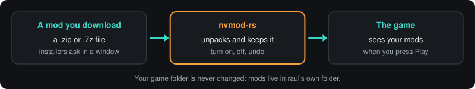
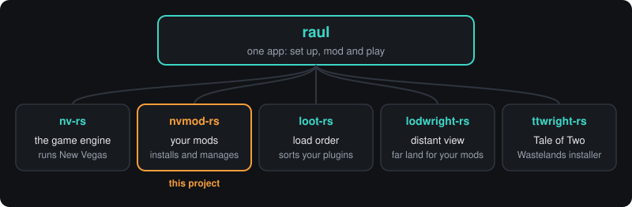

# nvmod-rs

**nvmod installs and manages mods for Fallout: New Vegas and Tale of Two Wastelands**, on Linux, Windows and macOS.
Your game folder stays as it is: mods live in a folder of their own, and the game sees them when you play.

  

## What you see

nvmod is the **Mods** page of [raul](https://github.com/JorisJonkers-dev/rauls-trusty-toolbox): your mods in a list,
and a mod's installer asks its questions in the window.

  
  

## What it does for you

- 📦 **Installs mods** from their .zip or .7z files, installers included.
- 🔀 **Turn mods on and off**, change which one wins, remove them, and undo any change.
- ⚠️ **Finds problems**: two mods that change the same file, or a plugin that misses another one it needs.
- 💾 **Backs up** your profiles and saves, and moves an existing Mod Organizer 2 setup over.

<!-- Progress picture: docs/coverage/tally.svg goes here once the feature catalogue reaches this repository. -->

## How it fits together

  

nvmod is one part of raul and only manages mods; raul runs the other steps. As its own project it is tested on its own.

## Get it

**[Download raul](https://github.com/JorisJonkers-dev/rauls-trusty-toolbox/releases/latest)**: nvmod is built in.
It also works on its own from the command line ([docs/USAGE.md](docs/USAGE.md)).

## Learn more

- [Using nvmod](docs/USAGE.md): raul's Mods and Load order pages, the commands and the downloads.
- [More detail](docs/OVERVIEW.md): what it covers, working on it, the legal notice.

nvmod contains no game or mod files: you need your own copy of the game. Licence: GPL-3.0-only ([LICENSE](LICENSE)).
